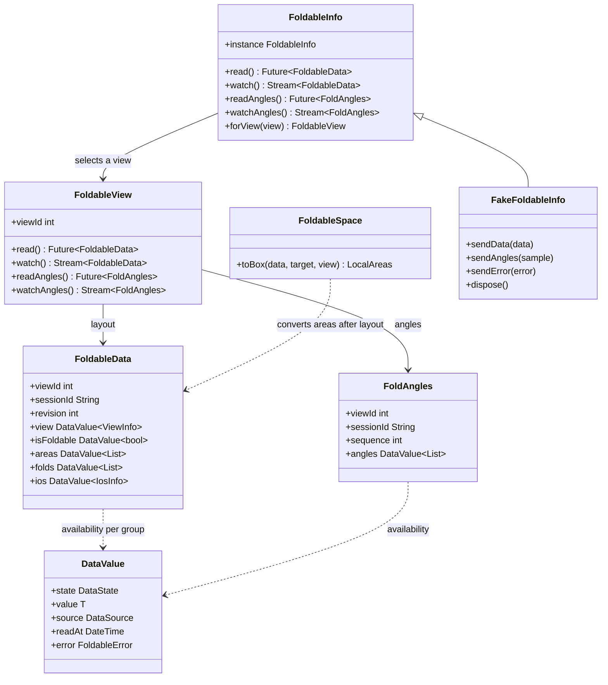

# API overview

The service reads measurements. The app chooses how to display them.

Static calls use the default service and engine's implicit view. Explicit handles
also allow injected fakes and choosing a Flutter view. Creating a handle does not
start native observation. A read is a one-shot request; streams share observation
until the last subscription/read ends. iOS currently supports only view ID 0.

## Main measurements

- ViewInfo: current size, physical/logical pixel ratio, safe padding, keyboard and
  gesture insets. Padding uses viewPadding and does not disappear behind a keyboard.
- ViewArea: frame, type, activity, margins and optional identifiers. Frames are
  in the view's coordinates until explicitly converted. A fold line can have zero
  width or height. An inactive fold may remain present in the list.
- FoldInfo: OS open state and direction where known. Not every platform supplies
  a direction or an identifier.
- FoldAngle: angle in degrees and optional fold identifier. It is independent
  from the OS fold state and from which areas currently block layout.
- IosInfo: UIKit size classes, native safe area and a preferred logical bar side.
  These are hints for a design system, not layout commands.

Check DataValue.state before using a value. Unknown, unavailable, unsupported and
an empty ready list describe different things. Timestamps and identifiers are
observations, not persistent device identifiers. Snapshot lists are immutable;
keep any custom DataValue value immutable too.
