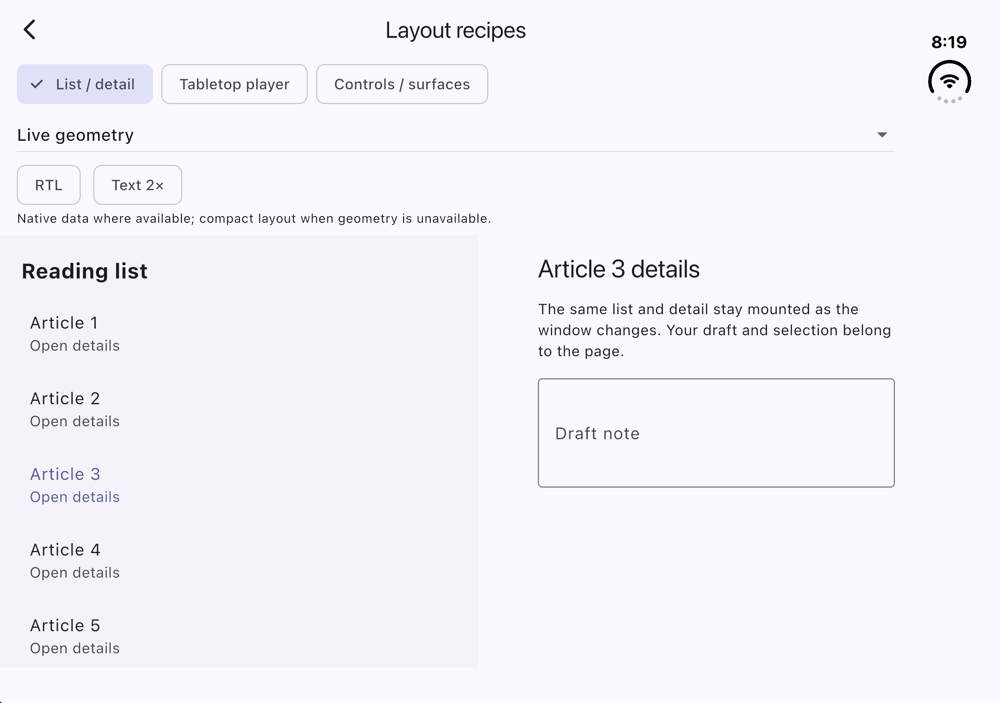
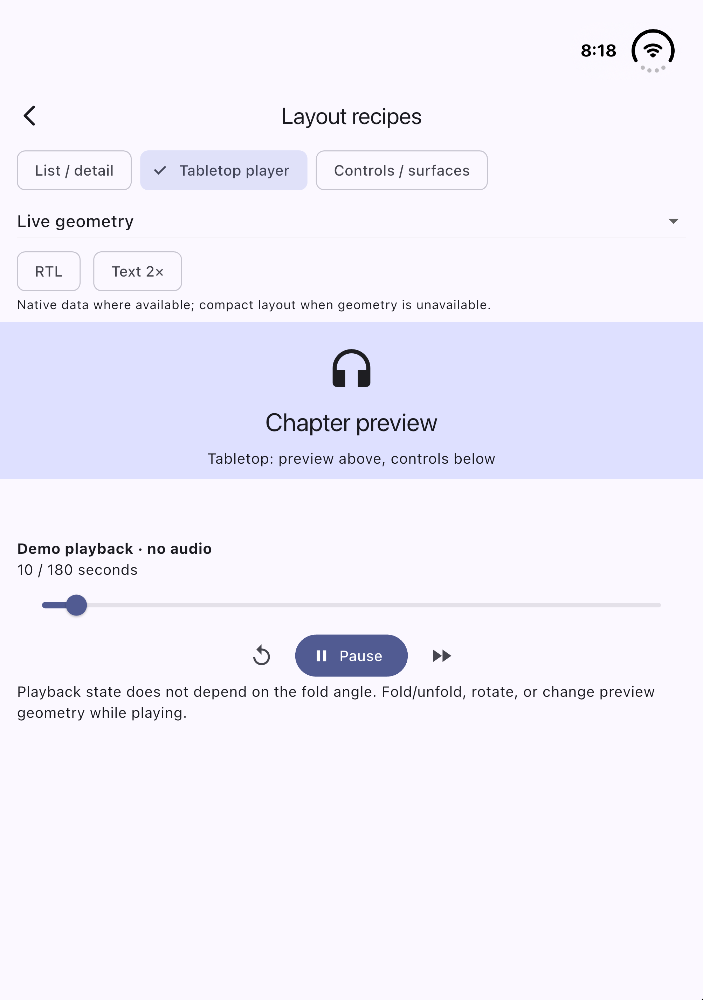
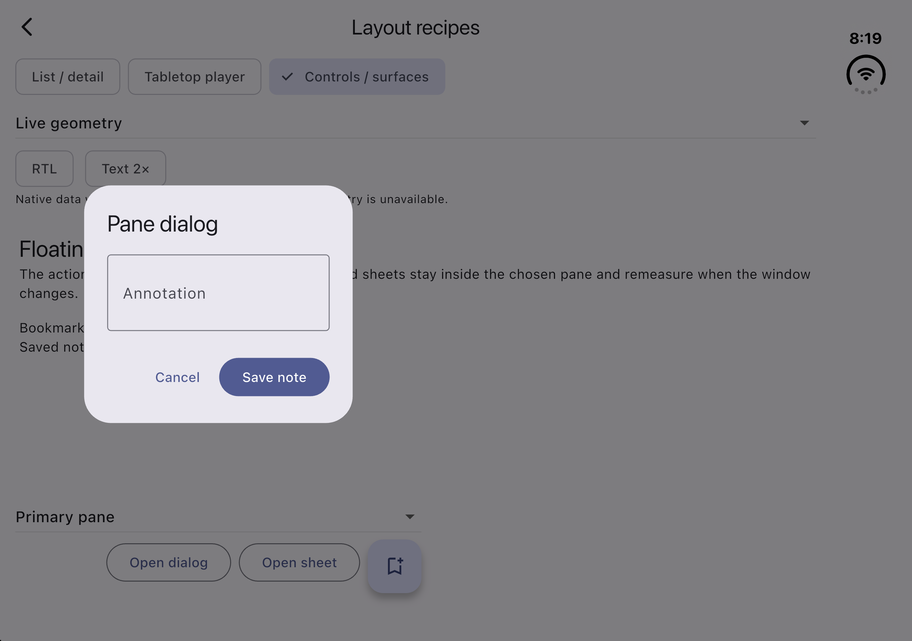
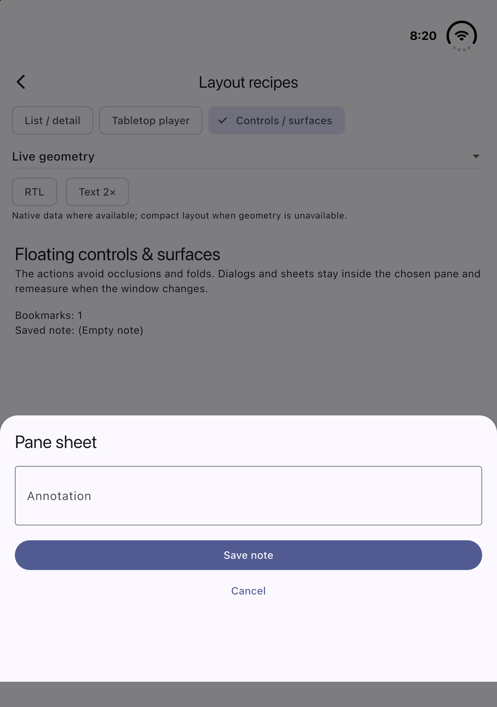

# Layout recipes

Open the example and tap **Layout recipes** (book icon in the app bar). Choose
**List / detail**, **Tabletop player**, or **Controls / surfaces**. Each recipe
has working interactions and uses only Flutter plus the public `foldable_info`
API. These are app-owned examples, not new exported scaffold/navigation APIs.

Start with **Live geometry** for native snapshots. Explicit **Illustrative book**,
**Illustrative tabletop** and **Illustrative no fold** choices let you explore
without a foldable device. They use calculated, labelled geometry in the current
view; they are not captured device poses, hardware detection or benchmark data.
Use **RTL** and **Text 2×** to inspect reading order and scrollable large text.

## Simulator examples

These images were captured with **Live geometry** on the iPhone Duo / iOS 27.1
simulator on 2026-11-10, Flutter 3.47.6. They are not physical-device evidence.

| Book: list and detail | Tabletop: preview and controls |
| --- | --- |
|  |  |

| Dialog in primary pane | Sheet in secondary pane |
| --- | --- |
|  |  |

## Shared rule: convert geometry into the actual canvas

The complete Flutter view and a canvas below an app bar rarely share an origin.
[RecipeGeometry](../example/lib/recipes/geometry.dart) calls the public
`FoldableSpace.toBox` after layout and rechecks after rendered frames, so a fold
outside the canvas does not become an invented center divider. It clips regions
to the canvas and rejects stale/unsupported transforms through the public API.
It does not request frames while idle.

```dart
final local = FoldableSpace.toBox(
  data: data,
  target: canvasRenderBox,
  view: View.of(context),
);
if (local.state == LocalState.ready) {
  // local.areas use this canvas's origin, including SafeArea/app-bar offsets.
}
```

A region may divide this canvas only if it spans it and leaves usable space on
both sides. The recipe respects activity and posture: an ordinary iOS fold that
still reports active after becoming flat is not treated as separating without
partly-open posture. A reported separating hinge can still divide a flat
Android dual-screen view. A zero-width fold remains meaningful. Margins already
included in an iOS frame are never added again.

The example keeps a 120-logical-pixel minimum pane extent, scaled with text size.
This is a demo policy, not a hardware rule. If a fold does not fit the canvas,
the recipe uses its ordinary compact layout. Each pane still wraps its content
in `FoldableSafeArea` to avoid active obstacles, even when a two-pane split is
rejected for insufficient space. A tiny pane scrolls rather than putting a
slider or text field across the fold. Unknown/unavailable geometry uses
that same fallback without declaring the device non-foldable. Initial geometry
settles after layout; these examples do not promise frame-perfect native timing.

Loading and stream failures keep the recipe slots mounted and show an ordinary
layout with an availability message. Flutter view metrics remain usable; the
fallback marks native groups loading/error rather than presenting an invented
ready-empty native list. Drafts and an open route's editor survive recovery.

## 1. List and detail

Source: [list_detail.dart](../example/lib/recipes/list_detail.dart).

- A vertical fold makes side-by-side panes; a horizontal fold makes top/bottom
  panes. The reserved gap stays empty.
- A wide ordinary window can use two panes at a text-scaled 720-pixel breakpoint.
  This width choice does not assert a physical fold or identify an inner screen.
- A compact window shows the list, then the selected detail; **Reading list**
  returns to the list. Both slots stay mounted, so selection, scroll state and
  the page-owned draft controller survive pose and compact/expanded changes.
- Primary is leading for a vertical split (right in RTL); primary stays above
  secondary for a horizontal split. Each pane scrolls independently.

Try selecting Article 3, typing a draft, switching book/no-fold modes and
resizing the window. The selected article and typed draft should remain.
The shared draft is intentionally page-level demo state, not separate stored
notes for each article.

## 2. Tabletop player

Source: [tabletop.dart](../example/lib/recipes/tabletop.dart).

A horizontal separating fold places the preview above the fold and controls
below it. A vertical separating fold puts controls in the secondary pane. Without
a usable fold, the player uses an ordinary stacked layout, labelled as such.

**Play/Pause**, the seek slider and ±15-second controls modify a local playback
simulation. There is no audio file, streaming provider or network request. The
page owns playback state and cancels its timer on disposal; changing geometry
never creates a new playback controller. A real audio app can pass its existing
player's state/actions into the same pane composition.

Layout follows current geometry/posture rather than raw-angle thresholds.
Each pane scrolls when controls or text need more room; text is not scaled down
to squeeze into a fold-sized box. The content rectangles come from the current
canvas, not an assumed 50/50 split of the physical display.

## 3. Floating controls, dialogs and sheets

Source: [surfaces.dart](../example/lib/recipes/surfaces.dart).

The bookmark action increments a counter. **Open dialog** and **Open sheet**
open a note editor; **Save note** returns its result to the page and **Cancel**
dismisses it. Pick **Primary pane** or **Secondary pane** before presenting.

The floating action group uses the existing public widget:

```dart
FoldableSafeArea(
  data: data,
  useSafeArea: false, // the example canvas is already inside SafeArea
  avoid: const {AreaType.blocked, AreaType.hinge, AreaType.fold},
  child: Align(
    alignment: AlignmentDirectional.bottomEnd,
    child: FloatingActionButton(
      onPressed: addBookmark,
      child: const Icon(Icons.bookmark_add_outlined),
    ),
  ),
)
```

The action group's largest-free-rectangle choice is independent of the target
pane chosen for a presentation. With unequal panes, it may sit in the larger
pane even when the next dialog targets the other one.

Each `showGeneralDialog` route subscribes to fresh snapshots itself, measures
its own safe viewport, selects the requested pane, then applies obstacle
avoidance within that pane. A sheet aligns to that pane's bottom. Keyboard
insets reduce the route viewport before geometry conversion. The editor remains
mounted while an already-open route moves between book, tabletop and no-fold
geometry. RTL changes primary/secondary ordering, not physical native frames.
Barrier dismissal and a Material dismissal label are supplied; modal routes
retain Flutter's normal focus/dismissal behavior.

No `MediaQuery.displayFeatures` bridge is installed, and this recipe does not
change other routes' behavior. The public package does not yet provide a
`showFoldableDialog` API: the example's route helper is intentionally local and
uses only exported measurements. See [Flutter's showGeneralDialog contract](https://api.flutter.dev/flutter/widgets/showGeneralDialog.html).

## Insets, keyboard and accessibility boundaries

The page consumes outer safe padding once. Local pane widgets do not apply the
same safe inset again. The page/route viewport resizes for the keyboard, then
recomputes its panes; Flutter's global bottom keyboard inset is not copied into
every pane. The outer space may shrink across both panes: this example does not
claim per-pane keyboard isolation. Each pane/editor remains independently
scrollable.

Controls have text labels or tooltips. Compact hidden panes are excluded from
focus and semantics; changing pane rectangles does not recreate their child
slots. RTL and 2× text are exercised in widget tests, together with route
repositioning and keyboard avoidance. This is not a claim of physical-device
or manual screen-reader certification. Always test your app's content, minimum
sizes and state ownership at the text scales it supports.
